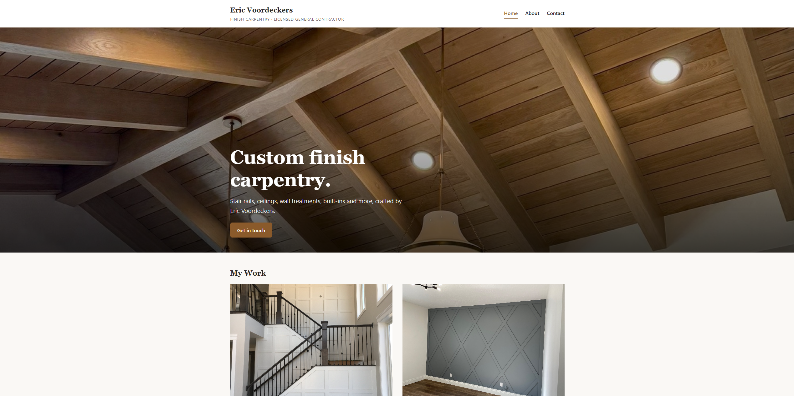

# Eric Voordeckers — Finish Carpentry Portfolio


**Live site:** https://ericvoordeckers.com



## About

This is a portfolio website I built for my dad, Eric Voordeckers. He's a finish carpenter and licensed general contractor
in Utah. He's spent 20 years in construction and carpentry and this site is dedicated to some of his favorite work. It 
showcases various stair rails, ceilings, wall treatments and custom built-ins as a way to show work to employers and clients. 

This site organizes 50+ projects into 8 categories, each with a photo gallery and slideshow. Eric manages it himself through a restricted admin account where he can add new jobs, upload photos, and see messages without touching code.

## Features
- **Category galleries:** 8 work categories. Upon selection a grid of projects are available to expand to full-screen and slide through with a keyboard or swipe navigation on mobile
- **Bulk photo upload:** select a whole folder of photos in the admin; they're
  processed and ordered by filename automatically
- **Image pipeline:** Every upload is rotated upright and resized to a 2000px display version and a 600px thumbnail version. Then images are stripped of any metadata, like GPS
- **Contact form:** Messages made on the Contact page are emailed to Eric. I included a honeypot field to filter spam and bots. 
- **Restricted admin role:** Created a "Content Editors" group that lets Eric manage projects, photos, and messages without access to users or site settings.
- **SEO and sharing:** Open Graph link previews, an XML sitemap, robots.txt, and a custom 404 page that can navigate back to the Home page


## Tech stack
| Area | Tools |
|---|---|
| Backend | Python 3.14, Django 6.1 |
| Database | PostgreSQL (production), SQLite (development) |
| Media storage | Cloudflare R2 via django-storages, Pillow for image processing |
| Email | Resend via django-anymail |
| Frontend | Django templates, plain CSS, GLightbox |
| Hosting | Docker, gunicorn, WhiteNoise, Railway |
| DNS / domain | Cloudflare |
| CI | GitHub Actions |

## Design decisions
**Protecting client privacy in photos.** Phone photos have embedded GPS coordinates in their EXIF metadata, and oftentimes these photos were taken inside clients' homes. This inclined me to ensure that every upload is re-encoded with Pillow without its metadata, so no location data ever makes it to the site. I checked this with a test that confirms GPS data is removed.

**Object storage for uploads.** Railway's filesystem is wiped on every deploy, so uploaded photos couldn't live on the server. Media goes to Cloudflare R2 behind a custom domain (media.ericvoordeckers.com), with year-long cache headers since each file name is unique. Locally, the same code saves to disk, and the environment decides which storage is used.

**Bulk upload instead of an import script.** I initially planned to use a command-line script to import photo folders into production. The downside was it would have required production database and storage credentials on my laptop. I instead built bulk upload into the admin to keep all credentials on the server, which gave Eric a way to add new work himself.

**Never losing a customer inquiry.** The contact form saves each message to the database prior to sending the email notification. In the case that an email delivery fails, the error is logged, the visitor still sees a confirmation, and the message is retrievable in the admin. A test simulates an email outage with a mock to verify this.

**Avoiding N+1 queries.** Gallery pages load all projects and their photos in 3 queries total using `prefetch_related`, instead of one query per project. An `assertNumQueries` test locks this in, and it caught a real regression when I later added link-preview images.

**Least privilege everywhere.** The R2 token can only read and write one bucket, the Resend API key can only send email from this domain, and Eric's admin account uses a group with only the permissions he needs.

## Running locally
Requires Python 3.14.

```powershell
git clone https://github.com/keatonvoordeckers/Voordeckers-Site.git
cd Voordeckers-Site
py -3.14 -m venv .venv
.\.venv\Scripts\Activate.ps1
pip install -r requirements.txt
```

Create a `.env` file in the project root:

```
SECRET_KEY=any-long-random-string
DEBUG=True
ALLOWED_HOSTS=127.0.0.1,localhost
```

Then set up the database and start the server:

```powershell
python manage.py migrate
python manage.py createsuperuser
python manage.py runserver
```

The site runs at http://127.0.0.1:8000 and the admin at /admin/. Migrations create
the 8 work categories automatically. Without R2 or Resend settings, uploads are
saved to `media/` and emails print to the console.

## Tests

```powershell
python manage.py test
```

20 tests cover:
- **Image processing:** resizing, EXIF/GPS removal, rotation of sideways phone photos
- **Models:** thumbnail generation, cover photo selection, unpublished projects
- **Gallery pages:** hidden unpublished work, 404s for unknown categories, query count
- **Contact form:** saving and emailing, validation errors, honeypot, email failure handling
- **SEO:** sitemap and robots.txt

Tests use in-memory file storage and Django's test email backend, so they never
touch R2 or send real email. GitHub Actions runs the Django system checks, a
missing-migration check, and the full test suite on every push.

## Deployment

The site runs on Railway as a Docker container. Pushing to `main` triggers GitHub
Actions; once it passes, Railway builds the Dockerfile, runs `collectstatic` during
the build, applies migrations on startup, and serves the app with gunicorn
(2 workers × 4 threads). WhiteNoise serves static files with compression and
fingerprinted filenames for long-term caching.

In production, the site enforces HTTPS with a one-year HSTS policy, secure cookies
and CSRF trusted origins.

### Environment variables

| Variable | Purpose |
|---|---|
| `SECRET_KEY` | Django cryptographic signing key |
| `DEBUG` | `True` locally; unset in production |
| `ALLOWED_HOSTS` | Domains the site will serve |
| `CSRF_TRUSTED_ORIGINS` | HTTPS origins allowed to submit forms |
| `DATABASE_URL` | PostgreSQL connection string |
| `R2_BUCKET`, `R2_ENDPOINT_URL`, `R2_ACCESS_KEY_ID`, `R2_SECRET_ACCESS_KEY`, `R2_PUBLIC_DOMAIN` | Cloudflare R2 media storage |
| `RESEND_API_KEY` | Sending-only key for contact form email |
| `CONTACT_EMAIL` | Where contact form messages are sent |